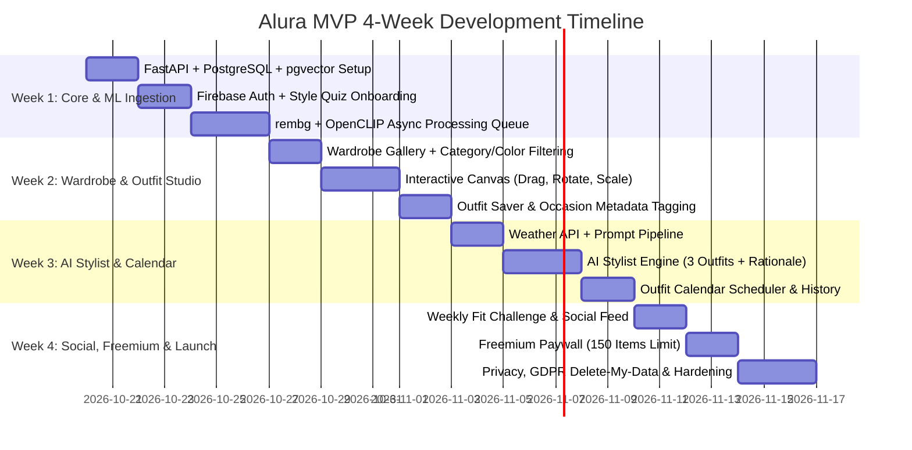

# 4-Week Solo Developer Build Plan: Alura AI Wardrobe

This battle-tested 4-week roadmap is optimized for a single full-stack/mobile/ML engineer working in agile sprints.

---

## Sprint Overview & Milestones

---

### Week 1: Foundation, Auth & Wardrobe ML Ingestion (Milestone 1 & 2 Core)
- **Day 1: Backend Infrastructure & Database**
  - Setup FastAPI boilerplate with async SQLAlchemy 2.0, Alembic migrations, and Pydantic v2.
  - Setup Docker Compose with PostgreSQL 16 (pgvector), MinIO, and Redis.
  - Configure Firebase Admin SDK JWT authentication middleware and local mock bypass mode.
- **Day 2: Mobile App Scaffolding & Design System**
  - Initialize Flutter project with Riverpod, Dio, and modern dark editorial theme.
  - Setup routing and persistent session token storage.
- **Day 3: Auth & Style Quiz Onboarding Flow (Milestone 1 Deliverable)**
  - Build interactive 4-step Style Preferences Quiz:
    - Step 1: Aesthetic/Vibe selector (gender-neutral chips).
    - Step 2: Harmonious color palette selection.
    - Step 3: Frequent occasions.
    - Step 4: Sizing & climate preferences.
  - Connect client quiz submission to `PUT /api/v1/users/me/preferences`.
- **Day 4–5: Async Image Pipeline (rembg + OpenCLIP)**
  - Implement client-side image compression (`flutter_image_compress`).
  - Implement upload endpoint streaming to MinIO storage.
  - Setup Redis background worker running `rembg` (ISNet) for high-precision background removal.
  - Run OpenCLIP `ViT-B/32` to generate 512-dim embedding and zero-shot classify category/color/season.

---

### Week 2: Digital Wardrobe & Drag-and-Drop Outfit Canvas (Milestones 2 & 3)
- **Day 6–7: Wardrobe Grid & Edit Studio**
  - Mobile staggered grid view showcasing transparent item cutouts.
  - Filter drawer (by category, color, season, favorites).
  - Manual item metadata edit dialog (override ML tags, add brand/size/notes).
- **Day 8–10: Drag-and-Drop Outfit Canvas**
  - Flutter multi-touch canvas using `GestureDetector` / `InteractiveViewer`:
    - Move, scale (pinch-to-zoom), rotate clothing cutouts on an editorial moodboard canvas.
    - Layering controls (bring to front, send to back via z-index).
    - Save canvas state as JSON (`{item_id, x, y, scale, rotation, z_index}`).
    - Render snapshot preview PNG via `RepaintBoundary`.
- **Day 11–12: Outfit Management**
  - Save outfit with name, occasion tags, and seasonal suitability.
  - List and inspect saved outfits with item breakdown.

---

### Week 3: AI Stylist & Daily Calendar (Milestones 4 & 5)
- **Day 13–14: Context Ingestion & Weather Integration**
  - Integrate Open-Meteo or WeatherAPI for real-time local weather (temp, condition, precipitation).
  - Context builder aggregating user wardrobe inventory + style preferences quiz + weather + occasion.
- **Day 15–17: LLM Stylist Engine**
  - Implement LLM prompt with strict JSON schema output (OpenAI / Claude / Gemini).
  - Constraint solver: Ensures suggested item IDs strictly exist in the user's wardrobe and adhere to coherent category rules (e.g. 1 top + 1 bottom OR 1 dress + 1 outerwear + 1 shoes).
  - Generates 3 distinct looks with editorial styling advice and occasion rationale.
  - Flutter UI displaying interactive carousel of the 3 outfits with one-tap "Save to Outfits" or "Wear Today".
- **Day 18–19: Outfit Calendar Scheduler**
  - Monthly and weekly agenda calendar view (`table_calendar`).
  - Assign saved or AI-suggested outfits to specific dates.
  - Mark outfits as "worn", automatically incrementing `wear_count` and logging last worn date.

---

### Week 4: Social, Freemium Limits, Privacy & Launch Readiness (Milestones 6 & 7)
- **Day 20–21: Social & Weekly "Fit Challenge"**
  - Curate weekly thematic challenge (e.g., "Monochrome Minimalism", "Rainy Day Chic").
  - Challenge submission workflow: select saved outfit, write a caption, post to challenge feed.
  - Public community feed with upvoting/likes, user profiles, and shareable deep links.
- **Day 22: Freemium Limits & Paywall**
  - Enforce 150-item hard limit on free tier wardrobe creation.
  - RevenueCat integration stub for "Alura Luxe" ($7.99/mo) with unlimited items and Phase 2 virtual try-on credits.
- **Day 23: Privacy & GDPR Delete-My-Data**
  - Complete `DELETE /api/v1/users/me/delete-data` endpoint wiping all database records and S3 asset buckets.
  - Private-by-default flag for all user wardrobes and outfits.
- **Day 24–28: End-to-End Testing, Performance Optimization & Polish**
  - Automated integration tests with `pytest`.
  - Image caching optimizations (`cached_network_image`).
  - Android APK compilation and smoke testing.
