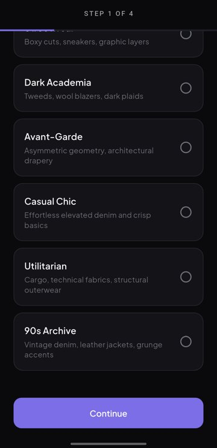
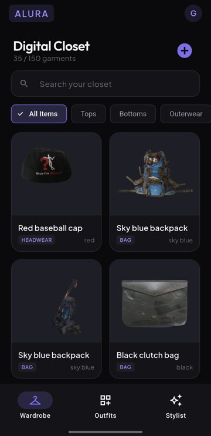
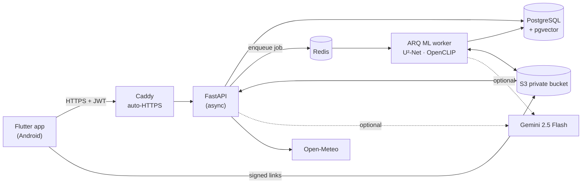
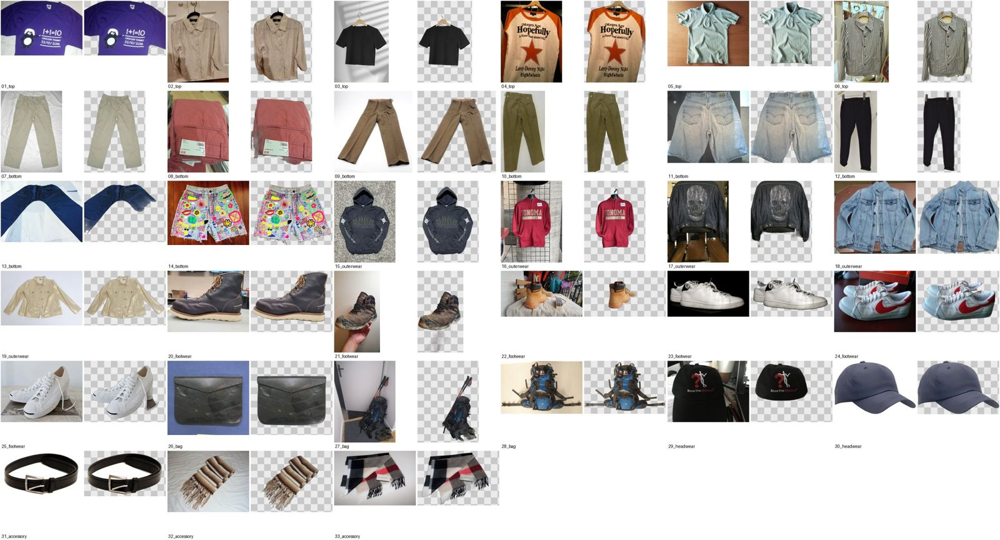

# Alura: AI wardrobe and stylist

Photograph your clothes, and Alura cuts each one out, works out what it is, and files it in a digital closet. It then builds outfits from what you own, with a stylist that looks at the weather, the occasion and what you've worn recently.

**Flutter app** · **FastAPI backend** · **PostgreSQL + pgvector** · **U²-Net, OpenCLIP, Gemini** · **AWS EC2 and S3**

<p>
  
  &nbsp;
  
</p>

## Features

- **Digital closet.** Upload a photo, and the background is removed. The garment is tagged with a category (top, bottom, outerwear, dress, one-piece, footwear, bag, headwear, accessory) and colours, and gets a name like "Black zip-up hoodie". You can search, filter, favourite and track wears.
- **Similar items.** "Find similar" ranks your other garments by CLIP embedding distance, served by a pgvector HNSW index.
- **Outfit maker.** Lay garments out on a canvas, save the outfit with a preview image, and tag it by occasion and season.
- **AI stylist.** Pick an occasion and get three looks for today's local weather (Open-Meteo). Restyle a look, or build one around a garment you choose.
- **Accounts.**
  - Sign in with email and password or Google, or start as a guest.
  - A guest can later save the account without losing anything.
  - You can change your password or sign out on all devices.
  - One tap deletes all your data.
- **Light and dark themes**, with a 4-step style quiz when you first open the app.

## Architecture



**An upload, step by step:**
1. The API saves the original photo to S3 and queues a job. It answers in about 50 ms.
2. The worker removes the background with **U²-Net**, cleans up stray fragments, and makes a thumbnail.
3. **OpenCLIP ViT-B/32** tags the category and colours zero-shot (no training) and stores a 512-d embedding in pgvector.
4. If a Gemini key is set, Gemini can also produce a white-background product shot and richer tags. If Gemini fails, the worker uses only the local pipeline.

**The stylist** is hybrid:
1. Gemini proposes looks from the wardrobe, the weather, the occasion and your preferences.
2. A deterministic rule engine scores garments by warmth, formality, colour harmony and recent wear. It checks and repairs the LLM's output.
3. Without Gemini, the rule engine produces the looks on its own.

## Benchmarks

The benchmark set is 33 freely licensed photos of real garments on beds, hangers and floors, labelled by hand. Full method and results are in [backend/benchmarks/README.md](backend/benchmarks/README.md).

**Background removal** (CPU only, 16 GB RAM):

| Model | Median time per photo | Peak RAM | Verdict |
|---|---|---|---|
| **U²-Net (used)** | **0.5 s** | **~1.0 GB** | Good on almost every photo |
| ISNet | 1.5 s | ~1.4 GB | Lost several garments |
| BiRefNet | 23 s | ~8.4 GB | Best on cluttered backgrounds, but needs a GPU |



**Tagging and search** (OpenCLIP, before and after prompt engineering):

| | Before | After |
|---|---|---|
| Category accuracy | 78.8% | **97.0%** |
| Colour accuracy | 63.6% | **72.7%** |
| Similarity search: top match has the same category | 87.9% | 87.9% |
| CLIP time per photo | 1.86 s | **0.35 s** |

The gains came from using several garment names per category and averaging the text embeddings over several phrasings, which are now cached. The same 33 photos guided those changes, so a larger held-out set is needed to confirm them.

**Live end-to-end test** (real API, Postgres and worker):
- **Uploads:** 33 of 33 processed with 0 failures. Photos are ready in about 2.1 s.
- **Stylist:** tested in Chennai (27.6 °C) and Oslo (9.5 °C) across 24 looks.
  - 0 rule violations and 100% complete outfits.
  - Outerwear in 0% of hot-weather looks and 100% of cold-weather looks.
  - Median latency 0.9 s.

## Security

- **Sessions:**
  - Signed JWT sessions that can be revoked. Changing your password signs out your other devices.
  - Passwords are hashed with scrypt.
  - Login takes the same time whether or not the email exists, so it can't be used to check for accounts.
  - Common passwords are rejected.
- **Abuse limits:** Redis-backed rate limits on login, sign-up, guest creation, uploads and stylist requests.
- **Private data:**
  - Every query is scoped to the signed-in user.
  - Photos live in a private S3 bucket and reach the app through signed links that expire after 24 hours.
- **Image handling:** decompression-bomb limits, input length limits, and generic error messages.
- **Hardening:**
  - Security headers, and API docs turned off in production.
  - CORS without credentials.
  - Non-root Docker image, and HTTPS with HSTS.
- **Android:** the session token is kept in encrypted storage, app data is excluded from backups, and plain HTTP is blocked.
- **Data clean-up:** a "delete all my data" option, and guest accounts that haven't been used for 30 days are removed automatically.

## Tech stack

| Layer | Technologies |
|---|---|
| Mobile | Flutter, Riverpod, Dio, flutter_secure_storage, google_sign_in |
| API | FastAPI, async SQLAlchemy 2, Pydantic v2, Alembic, PyJWT |
| Data | PostgreSQL 16 + pgvector (HNSW), Redis 7 |
| ML / AI | rembg (U²-Net), OpenCLIP ViT-B/32, Google Gemini 2.5 Flash |
| Infrastructure | Docker Compose, Caddy, AWS EC2 + Elastic IP, S3, IAM, Budgets |
| Tests | pytest (96 tests), Flutter test (29 tests), pip-audit |

## Project layout

```
backend/
  app/
    api/v1/endpoints/  auth, users, wardrobe, outfits, stylist
    services/          ml_pipeline, garment_studio, llm_stylist, similarity, storage, weather
    workers/           ARQ worker and the nightly guest clean-up
    core/              config, tokens, passwords, rate limits, production checks
  migrations/          Alembic
  benchmarks/          dataset builder, pipeline and live benchmarks
  tests/
mobile/lib/
  features/            auth, onboarding, home, wardrobe, outfits, stylist
  core/                theme, API client, shared widgets
docker-compose.yml       local services (Postgres, Redis, MinIO, API)
docker-compose.prod.yml  production (Postgres, Redis, API, worker, Caddy)
```

## Running it locally

```bash
# Backend
docker compose up -d db redis
cd backend
python -m venv .venv && source .venv/bin/activate   # Windows: .venv\Scripts\activate
pip install -r requirements.txt -r requirements-dev.txt
cp .env.example .env               # development mode: local storage and a dev sign-in
alembic upgrade head
python -m pytest tests
uvicorn app.main:app --host 0.0.0.0 --port 8000 --reload
python -m app.workers.arq_worker   # in a second terminal

# App (an Android emulator reaches the PC at 10.0.2.2)
cd mobile
flutter pub get
flutter run --dart-define=API_BASE_URL=http://10.0.2.2:8000/api/v1
```

API docs are at `http://localhost:8000/api/v1/docs` in development. To deploy to a server and build a signed release, see [DEPLOYMENT.md](DEPLOYMENT.md).

## Credits

The benchmark and screenshot garment photos are from Wikimedia Commons under CC0, public-domain, CC BY and CC BY-SA licences. Authors and licences are listed in [docs/CREDITS.md](docs/CREDITS.md).
